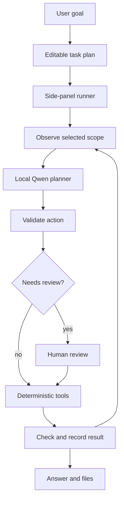

# Architecture and delivery boundaries

## Runtime

The browser side panel owns orchestration. The service worker opens the panel; it does not execute a hidden autonomous loop. DOM code runs in Chrome's isolated world and stores short-lived element references there. The model receives compact labels and IDs, never an executable browser script.

The Node backend handles local model calls, SQLite state, scoped files and Office generation. Only loopback Ollama URLs are accepted. Browser origins require a pairing token; optional extension-ID pinning narrows them further. No cookie extraction is required: clicks and inputs run inside signed-in tabs.

## Optimization for a 0.8B model

1. Use a short plan call, then one action per inference. Avoid requiring a long executable plan to be correct all at once.
2. Use Ollama JSON-schema output plus independent validators. Format validity does not imply correct reasoning.
3. Cap page text and controls; select goal-relevant text lines and prune whole context to a character budget. This is a heuristic, not tokenizer-exact budgeting.
4. Keep five recent actions, six conversation excerpts and four source excerpts in the request. Persistent history is larger than active inference context.
5. Retry malformed/invalid proposals once, then ask the user. Never fall back to unrestricted execution.
6. Keep the model warm, temperature zero, thinking disabled, 8K action context, and serial inference. Benchmark on the user's actual CPU/RAM.
7. Compute CSV statistics in code. Render Office files from structured data. Never ask the model to implement formulas or run generated programs at runtime.
8. Capture up to three independent browser snapshots in parallel. Model calls and writes remain ordered.

## Tool contracts

- Browser: `click`, `type`, `select`, `scroll`, `navigate`, `open_tab`, `switch_tab`, `extract`.
- Files: `read_file`, `analyze_csv`, `write_file`, `rename_file`, `create_artifact`.
- Control: `ask`, `done`.

The selected scope and read-only flag constrain the model schema and the UI's action validator. File mutations require a preview ticket bound to the proposed bytes and original SHA256. Commit consumes the ticket, rechecks the original file, and atomically installs the new file. No delete operation is exposed.

## Persistence and recovery

SQLite stores workspace sessions and preferences behind a monotonically increasing version. Writes use compare-and-swap inside a transaction. A conflicting browser is asked to reconnect rather than overwrite another browser's changes. Local storage is a cache, not a conflict-merging engine. Capture limits retain 30 sessions, 120 events/session, 20 sources/session and 30 recent actions.

A pending action is recorded before review/execution. If a run is interrupted with a pending action, the next run in that session is blocked until the user checks the outcome and starts a new session. This intentionally avoids blind replay; it is not exactly-once delivery across arbitrary websites.

## Next production work

1. Run actual Chrome and Qwen acceptance tests on target hardware. Fix the first failing workflows before broadening scope.
2. Add deterministic adapters for authorized target applications, with semantic postconditions (recipient identity + sent-message ID, saved-record ID, etc.).
3. Add full receipt/PDF/OCR ingestion with provenance, and full workbook/document readers.
4. Add durable worker orchestration and explicit recovery semantics for panel closure/crashes.
5. Add trusted connector adapters with scoped OAuth, then a signed plugin registry. Arbitrary model-generated plugins should never execute.
6. Add authenticated hosted sync, account isolation and encrypted transport only if cross-device access is required.
7. Evaluate LoRA or task distillation only after collecting representative, consented failure data and keeping a held-out set. Training code and weights are not included here.

These are future capabilities, not shipped claims.
